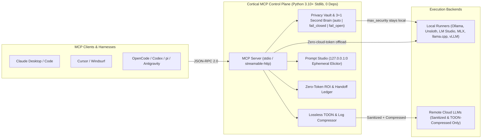

# Cortical

**Zero-dependency MCP control plane for private, local-first AI agents.**

[](https://glama.ai/mcp/servers/ccancellieri/cortical)
[](LICENSE)
[](pyproject.toml)
[](https://github.com/ccancellieri/cortical/stargazers)
[](https://ccancellieri.github.io/cortical/)

Cortical is a zero-server, Python 3.10+ standard-library (`dependencies = []`) MCP server and declarative agent control plane. It protects private files before they ever reach a cloud LLM, compresses structured payloads losslessly with `TOON`, offloads routine reads and reviews to local models at `$0` cloud cost, and synchronizes MCP configuration across 8 coding harnesses.

- **Live Zero-Install Demo:** [`ccancellieri.github.io/cortical`](https://ccancellieri.github.io/cortical/) | [`settings.html`](https://ccancellieri.github.io/cortical/settings.html) (zero CDNs, 3 one-click hardware presets)
- **Zero External Dependencies:** `dependencies = []` in [`pyproject.toml`](pyproject.toml). Auditable Python stdlib only, zero supply-chain bloat.
- **Zero Persistent Daemons:** Default `stdio` MCP transport. Interactive Prompt Studio (`cortical next`) binds a one-shot `127.0.0.1:0` loopback listener guarded by a 256-bit single-use token and shuts down immediately on submit.
- **Works With or Without Local LLMs:** Tier-1 Privacy Vault (`.md`, `.txt`, `.json`, `.docx`, `.xlsx`, `.pptx`, selectable `.pdf` metadata strip + PII/secret redaction + SHA-256 audit ledger), lossless `TOON` compression, `doctor`, and 8-harness `sync` run 100% deterministically in Python stdlib.

---

## 90-Second Video Demos

1. **[Privacy Vault + Lossless TOON (-78% Tokens) in pi CLI](https://youtu.be/zjdRGFkU8Cg)** - Zero-LLM `fail_closed` PII/metadata masking, deterministic TOON compression, and `$0` local offload.
2. **[Sync 8 AI Coding Harnesses with 1 Command + Rollback](https://youtu.be/HUvxYmrvhZc)** - Idempotent `--dry-run` sync, timestamped `--rollback`, and the static zero-CDN control plane (`settings.html`).
3. **[Run 27B Local Models at 65K Context on a 16GB Laptop](https://youtu.be/U5Cm3XAgsKM)** - Hardware preflight (`cortical doctor`), variable-quant 27B at `65,536` context in `9.08 GiB` VRAM, and local offload across 7 runners.

---

## Why Cortical

Most MCP servers are thin API wrappers that introduce heavy runtime dependencies, leave sensitive files exposed to cloud prompts, and force every developer to maintain separate configs for Claude Desktop, Cursor, Windsurf, OpenCode, Codex, and local runners.

Cortical solves the four architectural gaps that standalone wrappers leave open:

1. **Deterministic Fail-Closed Privacy Boundary:** Files classified as `max_security` or `fail_closed` cannot leave the machine. Structured PII, secrets, custom terms, and Office/PDF metadata are stripped locally with a verifiable SHA-256 ledger before any cloud call.
2. **Lossless Payload Compression (`TOON`):** Compresses JSON payloads by `-78.12%` vs pretty JSON (`-62.09%` vs compact JSON) with deterministic round-trip fidelity and automatic fallback when savings are below `10%`.
3. **Hardware-Aware Local Offload (7 Runners, 10 `@role:*` Slots):** Never hardcodes model tags. Maps semantic roles (`@role:router`, `@role:daily_coder`, `@role:reviewer`, `@role:summarizer`, `@role:deep_reasoner`, `@role:vision`, `@role:tech_communicator`) across `Ollama`, `Unsloth Studio`, `LM Studio`, `llama.cpp`, `Apple MLX`, `vLLM`, and any `openai_compatible` endpoint.
4. **Declarative Cross-Harness Sync + Prompt Studio:** Keeps MCP definitions, memory rules, and cross-harness handoffs aligned across `Claude Code`, `Cursor`, `Windsurf`, `Antigravity`, `OpenCode`, `Codex`, `pi`, `dsh`, and `Unsloth Studio` with `--dry-run` previews and timestamped `--rollback`.

---

## Architecture



---

## Quickstart (Copy-Paste, Zero Friction)

### Option A: Local Python (Zero External Dependencies)

```bash
git clone https://github.com/ccancellieri/cortical.git && cd cortical
python3 -m venv .venv && .venv/bin/pip install --no-deps -e .

# Verify hardware tier, Tier-1 Zero-LLM Privacy Vault & benchmarks
PYTHONPATH=src .venv/bin/python -m cortical.cli doctor
PYTHONPATH=src .venv/bin/python -m cortical.cli bench --compare
```

### Option B: Docker (Reproducible Containerized MCP)

```bash
docker build -t cortical-mcp .
docker run -i --rm cortical-mcp
```

### Option C: Connect Your MCP Client

#### Claude Desktop (`claude_desktop_config.json`)

```json
{
  "mcpServers": {
    "cortical": {
      "command": "python3",
      "args": ["-m", "cortical.mcp_server"],
      "env": {
        "PYTHONPATH": "/absolute/path/to/cortical/src",
        "CORTICAL_VAULT_DB": "/absolute/path/to/cortical/.cortical_data/vault.db"
      }
    }
  }
}
```

#### Cursor (`.cursor/mcp.json`) & Windsurf (`~/.codeium/windsurf/mcp_config.json`)

```json
{
  "mcpServers": {
    "cortical": {
      "command": "docker",
      "args": ["run", "-i", "--rm", "cortical-mcp"]
    }
  }
}
```

Or run `PYTHONPATH=src .venv/bin/python -m cortical.cli sync --dry-run` to preview automatic configuration across all 8 supported harnesses (see [`docs/INTEGRATIONS.md`](docs/INTEGRATIONS.md)).

---

## MCP Capabilities

Cortical exposes a focused surface of **8 Core Tools** (all with MCP `annotations` and `outputSchema`), **Native Resources**, and **3 Reusable Prompts**.

### Tools (8)

| Tool | Purpose | Key Inputs | Example Prompt |
| --- | --- | --- | --- |
| `cortical_ingest_private` | Sanitize a file, directory, or raw text into the Privacy Vault (`auto`, `fail_closed`, `fail_open`). | `path_or_text` (req), `alias`, `policy`, `profile`, `task_tags` | "Ingest `./contracts/client_brief.pdf` as `client_brief` with `fail_closed` policy." |
| `cortical_vault_read` | Read a sanitized vault item or task-tagged group at 3+1 depth (`light`, `medium`, `high`, `max`). Blocks `max_security` from cloud egress. | `alias`, `task_tag`, `tier` | "Read `@private:client_brief` at `medium` tier so we can draft the architecture plan safely." |
| `cortical_compress` | Deterministically compress JSON (lossless `TOON`), XML, YAML, or verbose logs. | `text` (req), `format` | "Compress this API response JSON using `cortical_compress` before storing it in context." |
| `cortical_doctor_status` | Inspect CPU/RAM/GPU tier, active local runners, and composed OSS tools (`Serena`, `RTK`). | *(none)* | "Run `cortical_doctor_status` to check which local models fit my 16 GB laptop." |
| `cortical_local_offload` | Delegate file reading, summarization, or code review to a local runner via `@role:*` at `$0` cloud tokens. | `prompt` (req), `role`, `model`, `file_paths`, `vault_alias` | "Offload reviewing `src/cortical/mcp_server.py` to `@role:reviewer` using `cortical_local_offload`." |
| `cortical_roi_report` | Compute local vs. cloud token usage, USD savings, and remaining cloud budget at zero cloud token cost. | `conversation_id`, `include_local_summary` | "Generate my session token savings report with `cortical_roi_report`." |
| `cortical_handoff` | Save or load structured task context (goal, modified files, next step) when switching between harnesses. | `action` (req: `save`\|`load`), `goal`, `summary`, `modified_files`, `next_step` | "Save a cross-harness handoff so I can resume this refactor in OpenCode." |
| `cortical_next_prompt` | Harvest repo/issue/ADR state, run the 5-Trigger confidence gate or ephemeral browser questionnaire, and synthesize a high-precision continuation prompt. | `seed`, `mode`, `persona`, `lang`, `detail_tier`, `attach_paths`, `target` | "Run `cortical_next_prompt` in `colleague` mode on my project folder to plan the next milestone." |

### Resources & Prompts

| Type | Identifier | Description |
| --- | --- | --- |
| **Resource** | `cortical://private/<alias>` | Sanitized read-only view of any vault item (automatically blocks `max_security` from remote cloud egress). |
| **Resource** | `cortical://brain` | Factorized 3+1 Local Second Brain index (concepts, reconciled facts, tasks, curated skills). |
| **Prompt** | `cortical-private` | Inject sanitized `@private:<alias>` context into the active conversation (omit `alias` to list items). |
| **Prompt** | `cortical-local` | Execute a task offline on the configured local model runner without spending cloud tokens. |
| **Prompt** | `cortical-next-prompt` | Launch Prompt Studio to synthesize or interactively elicit the next continuation prompt. |

---

## 2-Tier Capability Matrix & Reproducible Benchmarks

Measured offline via `PYTHONPATH=src .venv/bin/python -m cortical.cli bench --compare` and [`docs/METRICS_LEDGER.md`](docs/METRICS_LEDGER.md):

| Capability | Execution Tier | Local LLM Needed? | Verified Result |
| --- | --- | --- | --- |
| **Privacy Vault, Metadata Strip & SHA-256 Ledger** | Tier 1 (Zero-LLM Stdlib) | No | `100%` structured PII masked, `100%` technical prose preserved |
| **Lossless `TOON` Compression** | Tier 1 (Zero-LLM Stdlib) | No | `-78.12%` vs pretty JSON (`-62.09%` vs compact JSON) |
| **Hardware Preflight & 8-Harness `sync`** | Tier 1 (Zero-LLM Stdlib) | No | `--dry-run` preview + timestamped `--rollback <id>` |
| **Lean 8-Tool MCP Handshake** | Tier 1 (Zero-LLM Stdlib) | No | `~1-4 ms` ingest+read round-trip, zero external deps |
| **Local Offload (`file_paths`) & Vision OCR** | Tier 2 (Local Runner) | Yes (`@role:*`) | `-95.80%` cloud input tokens at `$0` cloud cost |

---

## Daily CLI Commands & Verification

```bash
# Workspace init, IDE integration & drift reconciliation
PYTHONPATH=src .venv/bin/python -m cortical.cli init -y
PYTHONPATH=src .venv/bin/python -m cortical.cli integrate --list
PYTHONPATH=src .venv/bin/python -m cortical.cli reconcile --dry-run --json

# Privacy Vault, Bulk Disk Privatizer & AI Colleague Prompt Studio
PYTHONPATH=src .venv/bin/python -m cortical.cli privatize ./client_docs --tier medium
PYTHONPATH=src .venv/bin/python -m cortical.cli colleague "Prepare an anonymized risk summary" --attach ./client_docs
PYTHONPATH=src .venv/bin/python -m cortical.cli next "Add multi-runner health metrics" --target pi

# Static zero-CDN browser control plane, ROI telemetry & test suite (64/64 passing)
PYTHONPATH=src .venv/bin/python -m cortical.cli dashboard --out-dir html --open
PYTHONPATH=src .venv/bin/python -m cortical.cli roi
PYTHONPATH=src .venv/bin/python -m unittest discover -s tests -q
```

Codebase footprint (`v0.3.0`, verifiable via `wc -l`): **7 Python subpackages** totaling `22,230` LOC (`18,139` Core Python/CLI/Second Brain/Prompt Studio/Wiki + `4,091` embedded zero-CDN SPA modules) backed by `64/64` passing `unittest` tests (`3,224` test LOC). See [`SECURITY.md`](SECURITY.md) for the fail-closed security policy and [`docs/adr/README.md`](docs/adr/README.md) for Architecture Decision Records.

---

## Author & Vision

**Cortical** is designed and maintained by **[Carlo Cancellieri](https://github.com/ccancellieri)**, Software Architect and open-source builder focused on local-first AI infrastructure, privacy-preserving developer tooling, and verifiable multi-agent systems.

The vision behind Cortical is pragmatic: developers and professionals should not have to choose between frontier AI productivity and data sovereignty. By keeping the control plane zero-dependency, auditable, and strictly local-first, Cortical makes privacy guardrails, lossless token economics, and multi-runner orchestration a default layer rather than an afterthought.

- **GitHub:** [github.com/ccancellieri](https://github.com/ccancellieri)
- **Live Control Plane & Docs:** [ccancellieri.github.io/cortical](https://ccancellieri.github.io/cortical/)
- **License:** [Apache-2.0](LICENSE)
