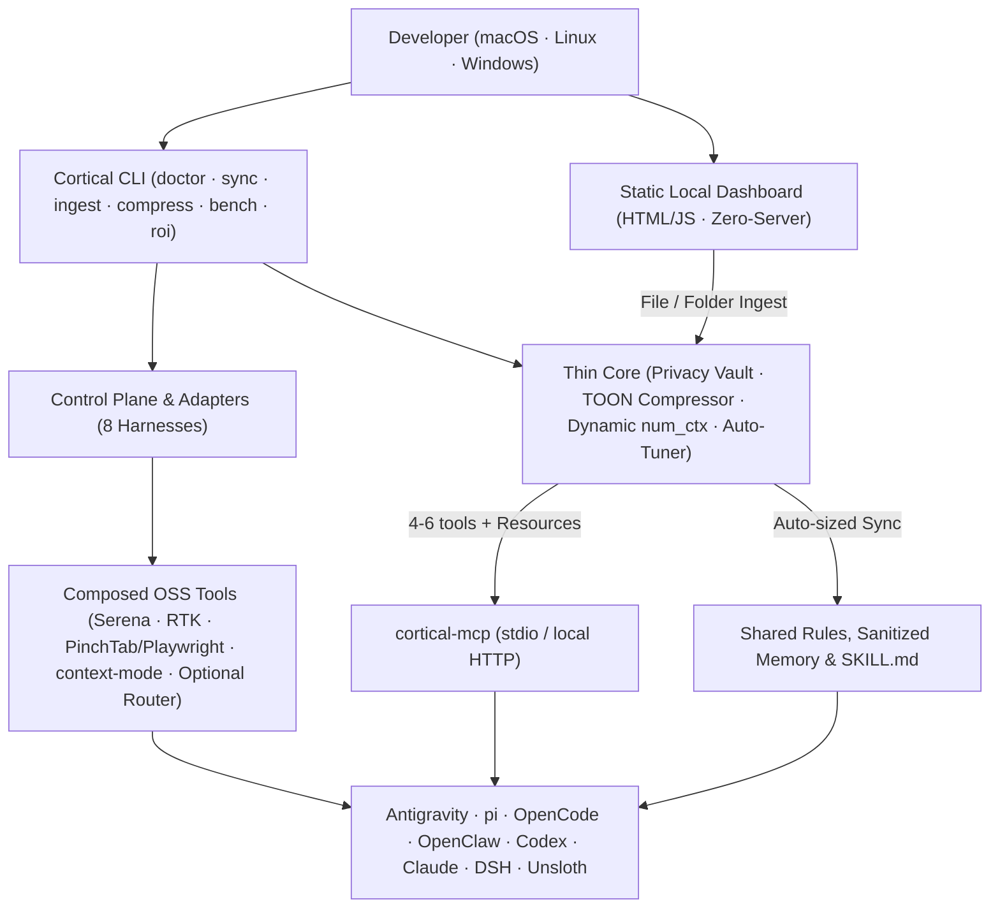

# Cortical Architecture & Design Specification

> **Status:** Validated Design (Brainstorming Handoff)  
> **Scope:** Cross-platform Control Plane & Multi-Harness Composer (`macOS`, `Linux`, `Windows`) + Thin Privacy, Compression & Auto-Tuning Core  
> **Core Principle:** Zero-Server by default · Python 3.10+ stdlib-only core (`dependencies = []`) · Compose mature OSS leaders instead of reinventing them

---

## 1. Understanding Summary

- **What we are building:** **Cortical**, a cross-platform Control Plane and Declarative Composer that installs, synchronizes, and continuously optimizes an economical, productive, and privacy-aware AI coding stack across **8 agent harnesses** (`Antigravity`, `pi`, `OpenCode`, `OpenClaw`, `Codex CLI`, `Claude Code`, `DeepSeek Harness`, `Unsloth Studio`).
- **Why it exists:** Developers wanting real token reduction, local LLM execution (including lightweight web browsing), and GDPR/privacy safety currently juggle 6–7 standalone tools across incompatible per-harness configs—paying redundant MCP schema bloat, missing `num_ctx` scaling, or pasting sensitive files manually into cloud chats. Cortical unifies everything from one declarative configuration and static local UI.
- **Who it is for:** Open-source developers, consultants, and solo engineers on variable hardware—from `4 GB VRAM + 16 GB RAM` laptops to `64 GB+` workstations—who want reproducible savings without heavyweight infrastructure.
- **Compose vs Own Boundary:**
  - *Composed best-of-breed OSS tools:* **Serena** (LSP symbol code navigation/editing), **RTK** (sub-10 ms shell output compression), **PinchTab / Playwright Snapshot** + **Crawl4AI** (token-light & local web browsing), **`context-mode`** (heavy tool output sandboxing), **LiteLLM / OmniRoute / Claude Code Router** (optional HTTP model router), and **Ollama / Unsloth Studio** (local inference runtimes).
  - *Owned thin Cortical core:* Cross-platform Hardware Preflight & Dynamic `num_ctx`, 8-Harness Declarative Sync (with backup/rollback), Dynamic Privacy Vault (`auto` / `fail_closed` / `fail_open`) + Transparent Injection, Deterministic Lossless Compression (`TOON` & structured/log formats), Local Auto-Tuner & Comparative Benchmark (`before vs after`).
- **Explicit Non-Goals (archived to `legacy-v0.2` branch/tag):**
  - Remove monolithic custom web server (`server.py`), custom chat web UI (`ui/`), voice/TTS subsystem (`voice/`), DuckDNS/tunnel gateway (`remote_gateway.py`), and custom browser engine (`grounding.py`) from `main`.
  - No duplicate source-code AST/Merkle indexing competing with Serena's real LSP layer.
  - No HTTP proxy hijacking claims over Antigravity's managed cloud backend (Antigravity is optimized strictly through lean MCP tools, synced rules/skills, shell filtering, and delegation to local MCP workers).

---

## 2. Non-Functional Requirements & Explicit Assumptions

| Dimension | Target / Requirement | Assumption / Verification |
| --- | --- | --- |
| **Performance** | `cortical doctor` / `sync` / `compress` `< 200 ms`; `cortical-mcp` stdio handshake `< 500 ms`; idle RAM/CPU `= 0` in Zero-Server mode | Measured locally via offline CLI benchmarks; shell compression runs via RTK (`< 10 ms`) |
| **Scale** | Single workstation across 3 OS (`macOS`, `Linux`, `Windows`), up to ~8 harnesses and dozens/hundreds of ingested local documents | Designed for developer workstations and local SQLite WAL, not multi-tenant cloud DBs |
| **Privacy & Security** | Dynamic per-item/folder policy (`auto` \| `fail_closed` \| `fail_open`); zero naive capitalized-bigram false positives on technical docs; automatic `.*ignore` rules; fail-closed stops any cloud exposure if local sanitization fails | Pre-send interception enabled **only** where 100% network-preemptive block is guaranteed (`pi`/CLI hooks or optional HTTP proxy); closed GUIs explicitly marked *Dashboard Ingest Only* |
| **Cross-Platform Reliability** | Zero bash-only core scripts; timestamped backups before modifying harness configs; `--dry-run` + `--rollback`; graceful degradation if optional external tools are absent | Windows falls back to hash-verified file copy when unprivileged symlinks fail; UTF-8 enforced everywhere |
| **Simplicity Gate** | Target core on `main`: `~3.5K–4.5K` LOC (`dependencies = []`) | `@private:` MCP Resources stay in core *only* if autocompletion works cleanly across target harnesses; otherwise simplified to synced memories/skills + upstream Serena/proxy patches |

---

## 3. Decision Log (`D1`–`D10`)

| ID | Decision | Alternatives Considered | Rationale |
| --- | --- | --- | --- |
| **D1** | Product name strictly **Cortical** (versions live on release/tags only) | Version-suffixed product title | Clean OSS identity and proper semver releases |
| **D2** | Identity: **Multi-Harness Composer & Control Plane + Thin Core** | All-in-one monolithic platform / static dotfiles script | Reuses 30K–185K★ OSS specialists while owning real gaps (sync, hardware `num_ctx`, privacy UX, compression) |
| **D3** | Day-1 support for **macOS, Linux, Windows** + variable hardware gating; archive old monolite to `legacy-v0.2` | macOS 16 GB assumption; keeping `32K` LOC on `main` | Eliminates scope creep and enables broad OSS adoption across laptop and desktop rigs |
| **D4** | **Zero-Server by default** + **Optional HTTP Router plugin** (`LiteLLM` / `OmniRoute` / `CCR`) on demand | Always-on proxy daemon / strict no-router CLI | Zero idle overhead by default while unlocking 70–90% API offload on CLI harnesses when desired |
| **D5** | **8 Target Harnesses:** `Antigravity`, `pi`, `OpenCode`, `OpenClaw`, `Codex`, `Claude Code`, `DeepSeek Harness (dsh)`, `Unsloth Studio` | Supporting only 2–3 tools | Covers complete multi-agent coding and local fine-tuning/inference workflows uniformly |
| **D6** | **Deterministic lossless multi-format compression (`TOON`, compact JSON/YAML/log)** paired with Serena/RTK/PinchTab/`context-mode` | Keeping raw JSON dumps or lossy summaries for code/data | Cuts 30–60% tokens on uniform JSON safely with zero model hallucinations |
| **D7** | **Approach A:** Declarative Control Plane + Thin `cortical-mcp` (`4–6` tools) + Static Privacy/ROI Dashboard | Universal MCP-in-the-middle proxy (Approach B) / Zero-MCP CLI only (Approach C) | Avoids nested MCP proxy fragility while still providing native MCP Resources and seamless memory sync |
| **D8** | Dynamic ingestion policy **`auto` \| `fail_closed` \| `fail_open`** per file, folder, and scanned content | Blanket fail-closed on everything | Balances strict leak protection on sensitive files with zero friction on clean public/technical docs |
| **D9** | Explicit **Tier 1A Hybrid Laptop (`16 GB RAM + 4–6 GB VRAM`)** alongside Tier 0, Tier 1B, Tier 2, Tier 3 | Jumping straight from `<12 GB` to `8–12 GB VRAM` | Real-world gaming/dev laptops (`4 GB` NVIDIA + `16 GB` RAM) comfortably run `1.5B–3B` resident + quantized `7B–8B` |
| **D10** | **Channel 3 (On-the-Fly Chat Attachment Interception)** enabled strictly on harnesses/proxies with **100% verified pre-send guarantees** | Best-effort client interception everywhere | Prevents false security promises on closed desktop hosts like Antigravity |

---

## 4. Architecture & Data Flow



### 4.1 Target Package Layout on `main` (`~3.5K–4.5K` LOC)

```text
src/cortical/
  hardware/      # Cross-platform RAM/VRAM/GPU probes, Tier 0..3 classifier, dynamic num_ctx
  harnesses/     # 8 clean adapters (~60-90 LOC each) + backup/dry-run/rollback + schema diet
  composers/     # Declarative installers & configs for Serena, RTK, PinchTab/Playwright, context-mode, Router
  privacy/       # Metadata stripper, structured PII + local 1.5B-3B JSON NER, dynamic auto/fail-closed/open Vault
  compression/   # Deterministic TOON encoder/decoder (>=10% guard), YAML/CSV/XML/log trimmers, context budgeting
  analytics/     # Zero-cloud-token transcript scanner, static dashboards, local Auto-Tuner & before/after benchmark
```

---

## 5. Hardware Preflight & Cross-Platform Adaptation

`cortical doctor` inspects hardware cleanly using Python stdlib (`vm_stat`/`sysctl` on macOS, `/proc/meminfo` on Linux, `ctypes` `GlobalMemoryStatusEx` on Windows, plus `nvidia-smi`, Apple Metal, Ollama `/api/tags`, and Unsloth `/api/health`) and classifies whether and what to install:

| Tier | Detected Hardware Profile | Recommended Local Model & Context Cap | Composed External Tools |
| --- | --- | --- | --- |
| **Tier 0 (Lean)** | `< 12 GB` RAM and `< 4 GB` VRAM | No heavy local LLM inference (cloud + minimal regex/deterministic compression) | **Serena**, **RTK**, **PinchTab / Playwright**, **TOON** |
| **Tier 1A (Hybrid Laptop)** | `16 GB` RAM + `4–6 GB` NVIDIA/AMD VRAM | `1.5B–3B` resident in VRAM (NER / routing / triage) + quantized `7B–8B` hybrid offload (`8K–16K` `num_ctx`) | Tier 0 stack + **Ollama / Unsloth** (`1.5B`–`8B`) |
| **Tier 1B (Unified 16–24)** | `16–24 GB` Unified Memory (Apple Silicon) or `8–12 GB` VRAM | `9B` `UD-Q3_K_XL` (`~5.1 GB`, `32K–131K` `num_ctx`) daily + **Unsloth variable/dynamic quantized `27B`** (`4-bit XXS ~8.1 GB` or `UD-IQ2_XXS ~7.2 GB`) for deep reasoning & local orchestration | Tier 0 stack + lightweight local browser worker |
| **Tier 2 (Pro Workstation)** | `32–64 GB` RAM or `24 GB+` VRAM | `27B–32B+` coder/reasoner with high tool-calling reliability | Full stack + optional **HTTP Router** (`70–90%` local offload) |
| **Tier 3 (Multi-GPU / Studio)** | `64 GB+` Unified / Multi-GPU CUDA | Full heavy/vision + multi-model parallel local loops | Full stack + HTTP Router + autonomous local workers |

### 5.1 Model Selection, Variable Quantization & Custom Model Builder (`cortical models`)
- **Pre-Download Decision & Fit Assessment:** Before pulling any weights, `cortical models recommend` evaluates free RAM, VRAM, and unified memory headroom against built-in + custom model entries (`optimal_vram`, `optimal_unified`, `hybrid_ram_vram`, `tight`, `too_large`), including **Unsloth Dynamic / Variable Quantization** (`UD-IQ2_XXS ~7.2 GB`, `4-bit XXS ~8.1 GB`, `UD-Q3_K_XL ~5.1 GB`) which let a `27B` reasoning/orchestration model run cleanly on `16 GB` unified RAM without swapping.
- **Custom Model Registration (CLI & Static UI):** Both `cortical models add` and the **Settings Dashboard** expose an interactive form to register new GGUF/Ollama/Unsloth/MLX/llama.cpp models (`model_id`, `runner`, `memory_gb`, `native_ctx`, `quantization`, `is_variable_quant`, `roles`, `pull_ref`) stored declaratively in `cortical.config.json`.

---

## 6. 8 Harnesses Matrix (`cortical sync`)

Every adapter supports `--dry-run`, automatic timestamped backups (`~/.cortical/backups/<ts>/`), and `--rollback`.

| Harness | Config Target (macOS · Linux · Windows) | MCP & Models Synced | On-the-Fly Attachment Interception (Channel 3) |
| --- | --- | --- | --- |
| **Antigravity** | `~/.gemini/config/mcp_config.json` + `~/.gemini/GEMINI.md` | Serena (`--context antigravity`), Playwright/PinchTab, lean `cortical-mcp`, `unsloth-studio` | **No** (closed cloud transport; *Dashboard Ingest Only* + `.*ignore`) |
| **`pi`** | `~/.pi/agent/mcp.json`, `settings.json`, `models.json`, extensions | Serena (`--context ide`), `cortical-mcp`, dynamic Ollama/Router models | **Yes (100% Pre-Send)** via native extension pre-send hook |
| **OpenCode** | XDG / `%APPDATA%/opencode/` (`config.json`, `opencode.json`) | Serena (`--context ide`), `context-mode`, RTK hook, `baseURL` router/Ollama | **Yes (100% Pre-Send)** via plugin / optional HTTP router |
| **OpenClaw** | OpenClaw agent config (`mcp` + OpenAI/Anthropic provider) | Serena (`--context oaicompat-agent`), browser snapshot MCP, router `baseURL` | **Yes** via gateway / optional HTTP router |
| **Codex CLI** | `~/.codex/config.toml` (`%USERPROFILE%\.codex\config.toml`) | Serena, `context-mode`, `OPENAI_BASE_URL` router profile | **Via Optional HTTP Router** (`OPENAI_BASE_URL`) |
| **Claude Code** | `~/.claude.json` (`%USERPROFILE%\.claude.json`) via `claude mcp` / hooks | Serena (`--context claude-code`), RTK PreToolUse hook, `ANTHROPIC_BASE_URL` | **Yes (100% Pre-Send)** via `UserPromptSubmit`/`PreToolUse` hooks or CCR/router |
| **DeepSeek Harness (`dsh`)** | `~/.dsh/settings.yaml` / `%USERPROFILE%\.dsh\` (`@deepseek-ai/dsh-mcp-client`) | Serena, `cortical-mcp`, `base_url` pointed to local router/Ollama | **Via Plugin / Optional HTTP Router** |
| **Unsloth Studio** | Streamable HTTP endpoints (`cortical serve-mcp` Python cross-platform) + `unsloth start <agent>` | Serena (`oaicompat-agent`, HTTP `:9121/mcp`), Playwright/PinchTab HTTP | Acts as local engine + GUI consumer (Channel 1/2 synced resources & skills) |

---

## 7. Dynamic Privacy Ingestion, 3-Channel Exposure & Deterministic Compression

### 7.1 Per-Item / Folder Ingestion (`auto` | `fail_closed` | `fail_open`)
1. **Static Dashboard Upload or CLI (`cortical ingest <path> --policy auto|fail_closed|fail_open`):**
   - Strips hidden binary metadata (`docx`/`xlsx`/`pptx` `docProps/*`, PDF metadata tags, YAML author headers).
   - Runs fast deterministic detectors (`EMAIL`, `PHONE`, `IBAN`, `TAX_ID`, `SECRET`, user `custom_terms`).
   - Optionally runs a small local LLM (`1.5B–3B`) outputting strict JSON entities for genuine person/company names—eliminating the old naive `PERSON_NAME` regex (`87.5%` false positives on Title-Case technical words).
2. **Dynamic Policy Resolution (`auto`):**
   - Clean technical/public content with `0` sensitive triggers may resolve to `fail_open` (recorded explicitly in the local manifest).
   - Content containing PII, secrets, financial patterns, or user-marked sensitive folders resolves to **`fail_closed`**: raw originals are quarantined inside protected local storage (`.*ignore` generated across harnesses), and any local sanitization failure **aborts remote exposure completely**.

### 7.2 Transparent Exposure Without Chat Attachments
- **Channel 1 — Native MCP Resources (`cortical://private/<alias>`):** Clean `resources/list` exposure for `@` selection without leaking filesystem paths (gated by **Simplicity Gate**: retained only if ergonomics pass smoothly across harnesses).
- **Channel 2 — Auto-Sized Sanitized Memory & Skill Sync:** Cleaned, compressed takeaways/snippets are automatically written into harness-read rule/skill files (`AGENTS.md` / `SKILL.md` / memory summaries), capped dynamically by model context budget (`num_ctx`).
- **Channel 3 — Pre-Send Chat Interception (Where Verified 100% Safe):** On `pi`, Claude Code/OpenCode hooks, or when routed through the optional HTTP proxy, local files attached in prompts are intercepted *before* network dispatch, ingested locally into memory, and offered in anonymized + compressed form (or resolved completely offline).

### 7.3 Deterministic Lossless Compression (`cortical/compression/`)
- **TOON (`Token-Oriented Object Notation`)** for uniform JSON arrays/objects (`rows[N]{col1,col2}: ...`) with a deterministic **round-trip verifier and `>= 10%` savings guard** (automatically falls back to single-line compact JSON `separators=(",", ":")` on small or ragged objects).
- **YAML / CSV / XML / Log Compactors:** deduplicate repeating stack frames/timestamp lines, strip null fields and verbose formatting before injecting memory or piped CLI outputs.
- Paired cleanly with **RTK** (CLI shell compression), **`context-mode`** (heavy tool sandbox), and **PinchTab / Playwright accessibility trees** (`~800` tok/page instead of `12K+` HTML DOM or vision screenshots).

---

## 8. Continuous Local Auto-Tuning, Verification & Risks

### 8.1 Feedback Loop (`cortical/analytics/tuner.py`, 0 Cloud Tokens)
Reads local SQLite telemetry (`agent_runs`, mtime-cached remote transcripts, benchmark history) and recommends or applies targeted improvements:
1. **Model & `num_ctx` Tuning:** Promotes/demotes models per task role based on measured `tok/s`, timeout rate, and local completion rate—respecting hardware bounds (including Tier 1A `4 GB VRAM`).
2. **Skill Consolidation:** Identifies zero-usage or overlapping `SKILL.md` entries via Jaccard + optional local LLM merge, pruning dead prompt weight.
3. **Context Budget Sizing:** Caps synced memory + rules injection at `<= 15%` of the active model's effective `num_ctx`.

### 8.2 Verification Strategy
- **Offline Unit & Contract Suite (`.venv`):** Mocked cross-platform probes (`macOS`/`Linux`/`Windows` including Tier 1A `4 GB VRAM + 16 GB RAM`), golden config fixtures for all 8 harnesses, lossless TOON round-trip + `>=10%` guard tests, privacy classification matrix (`auto`/`fail_closed`/`fail_open`, zero false positives on technical prose), backup & rollback tests, pre-send hook enforcement tests.
- **Reproducible Comparative Benchmark (`cortical bench --compare`):** Runs standardized bilingual coding/browsing/privacy tasks comparing **unmodified baseline vs Cortical stack**, reporting cold vs warm runs, correctness, completion rate, cloud tokens, local tokens, wall latency, and missing telemetry honestly (following strict qualification discipline).

### 8.3 Open Risks & Mitigations

| Risk | Severity | Mitigation |
| --- | --- | --- |
| Harness config formats evolve (`dsh`, `OpenClaw`, `OpenCode`) | Medium | Isolate per-harness schemas into versioned 60–90 LOC adapters; always create timestamped backup + `--rollback` |
| Closed desktop apps (`Antigravity`) bypass HTTP routers & MCP resources inconsistently | High | Never promise pre-send interception on closed apps; rely on Channel 2 synced memories + `.*ignore`, validate MCP Resources early via Simplicity Gate |
| Small `4 GB VRAM` (`1.5B–3B`) JSON NER misses edge entities | Medium | Combine deterministic structural regexes (`EMAIL`/`IBAN`/`SECRET`/`TAX_ID`) + `custom_terms` + fail-closed fallback on `max_security` / uncertain scans |
| MCP schema overhead reduces savings if `cortical-mcp` grows | Medium | Hard-cap `cortical-mcp` at 4–6 tools; defer secondary MCPs wherever the harness supports lazy tool loading |

---

## 9. Living ADRs & v0.3 DX / Control Plane Extensions

All architectural and UX decisions beyond `D1`–`D10` are tracked in [`docs/adr/README.md`](./adr/README.md) and mirrored 1:1 to GitHub Issues (`label: adr`):

- **Zero-Server Dashboard (`ADR-001`..`ADR-004`, #20–#23):** `src/cortical/analytics/snapshot.py` + `src/cortical/analytics/zero_server_ui.py` generate the 6-domain offline-capable `docs/settings.html` hydrated with hardware tier, real `sync_harnesses(..., dry_run=True)` diffs, composed OSS tools, Privacy Vault aliases & `<= 15% num_ctx` gauge, ROI, `bench --compare`, and `docs/adr/` ADRs.
- **Opt-In Local HTTP Control Plane & Multi-Tenant Wiki (`ADR-005`..`ADR-006`, #10–#11):** `src/cortical/wiki/{store,mcp_server}.py`, `src/cortical/dashboard_api.py`, and `src/cortical/dashboard_ui.py` provide optional `--serve` SQLite WAL + FTS5 + Merkle-tree delta crawling + `principal_id` RBAC without changing the zero-server default or lean 7-tool `CorticalMCPServer` contract.
- **Zero-Friction DX, IDE Integration & SSOT (`ADR-007`, #29):** `src/cortical/workspace.py` (`cortical init`, Git-style `.cortical/` auto-discovery, `.corticalignore` sync — #8), `src/cortical/integrations.py` (`cortical integrate`, live stdio `doctor` — #9), `src/cortical/harnesses/chrome.py` (non-destructive `--autoConnect` + Tab Groups), and `scripts/cortical_overnight.py` (`1 Loop = 1 fresh pi session`).

